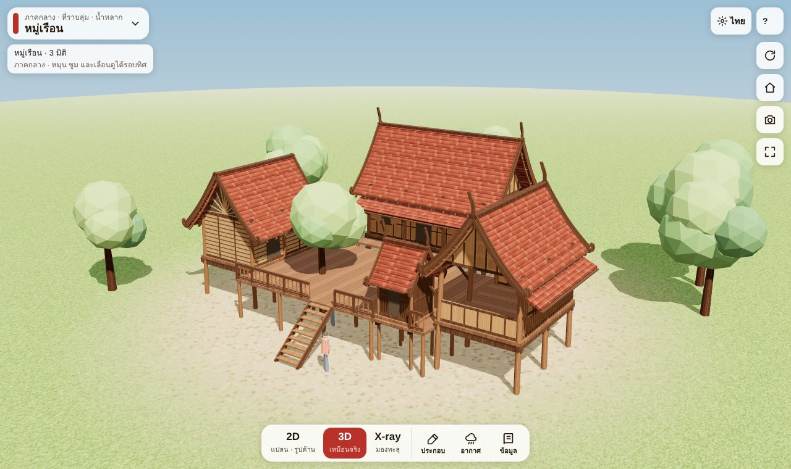
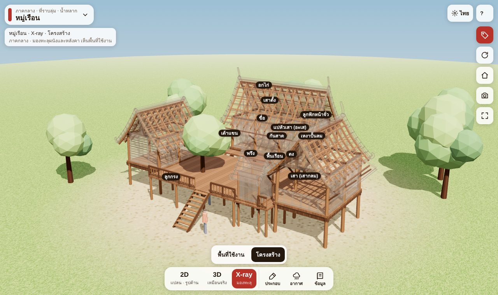
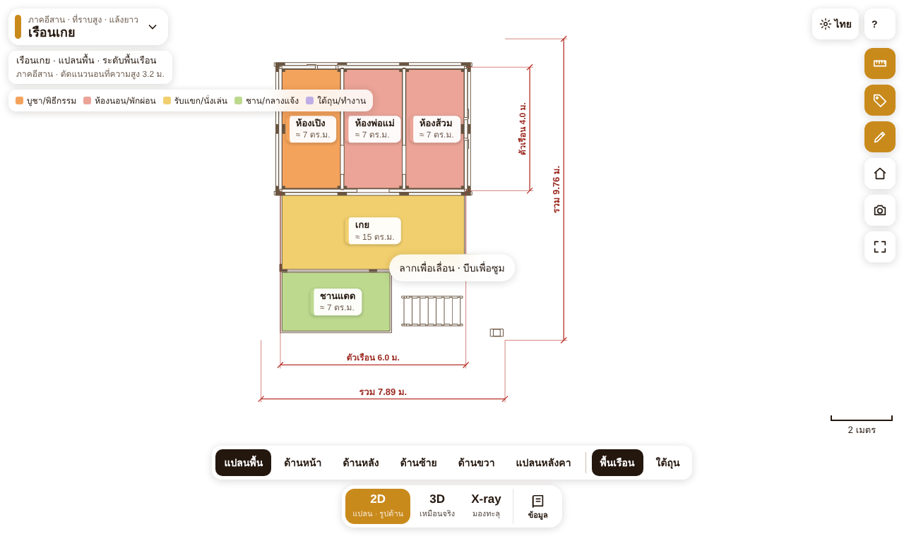
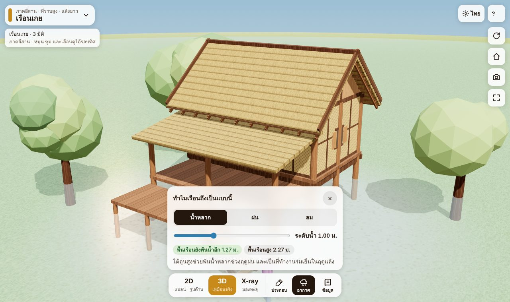
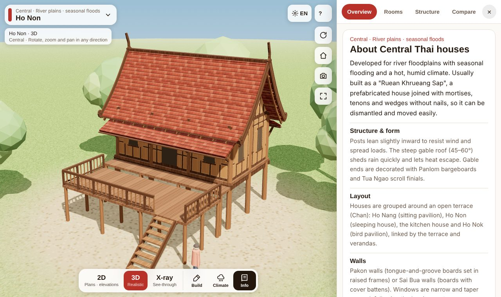

# เรือนไทย 4 ภาค · Traditional Thai Houses of 4 Regions

สื่อการสอนสถาปัตยกรรมพื้นถิ่นไทยแบบโต้ตอบได้ ใช้ดูเรือนไทยภาคกลาง เหนือ อีสาน และใต้ในแบบ 3 มิติ แปลน รูปด้าน และ X-ray พร้อมแอนิเมชันประกอบเรือนเครื่องสับ และการจำลองน้ำหลาก ฝน และลม ใช้ได้ 3 ภาษา (ไทย อังกฤษ จีน) บนคอมพิวเตอร์ แท็บเล็ต และมือถือ

**ทดลองใช้:** https://keng14.github.io/thai-houses-4-regions/



| X-ray โครงสร้าง | แปลน 2D พร้อมเส้นบอกระยะ |
| --- | --- |
|  |  |
| **จำลองน้ำหลาก ฝน ลม** | **แผงข้อมูล (ภาษาอังกฤษ)** |
|  |  |

## มีอะไรบ้าง

**อาคาร 13 หลังใน 4 ภาค**

| ภาค | อาคาร |
| --- | --- |
| ภาคกลาง | หมู่เรือน · หอนอน · เรือนครัว · หอนั่ง |
| ภาคเหนือ | เรือนกาแล · หลองข้าว |
| ภาคอีสาน | เรือนเกย · เรือนแฝด · เรือนโข่ง · เล้าข้าว |
| ภาคใต้ | เรือนหลังคาจั่ว · เรือนปั้นหยา · เรือนมนิลา |

**โหมดการดู**
- **3D** หมุน ซูม เลื่อนดูได้รอบทิศ
- **2D** แปลนพื้น (ระดับพื้นเรือนและใต้ถุน) รูปด้านทั้ง 4 ด้าน และแปลนหลังคา มีเส้นบอกระยะความกว้าง ความยาว และความสูงใต้ถุนเป็นเมตร
- **X-ray** มองทะลุผนังและหลังคา เลือกดู "พื้นที่ใช้งาน" (ห้องนอน ชาน ครัว ใต้ถุน ฯลฯ) หรือ "โครงสร้าง" (เสา รอด ตง พรึง ขื่อ อะเส เสาดั้ง อกไก่ จันทัน แป ระแนง ปั้นลม ตัวเหงา กันสาด เต้าแขน ฯลฯ)

**กิจกรรม**
- **ประกอบเรือน** แอนิเมชัน 12 ขั้น ตั้งแต่วางตีนเสาจนมุงหลังคา เล่น หยุด ย้อน และข้ามทีละขั้นได้
- **สภาพอากาศ** "ทำไมเรือนถึงเป็นแบบนี้" เลื่อนระดับน้ำหลากเทียบกับพื้นเรือน ดูน้ำฝนไหลตามความชันหลังคา และดูลมพัดผ่านใต้ถุน
- **แผงข้อมูล** ภาพรวมภาค พื้นที่ใช้งานพร้อมขนาด โครงสร้างและระบบเข้าไม้ และตารางเปรียบเทียบ 4 ภาค

**การใช้งาน**
- เปิดหน้ามาจะให้เลือกภาษาก่อน ตามด้วยวิธีใช้สั้น ๆ ในภาษานั้น แล้วจึงเข้าสู่หน้าใช้งาน
- ปุ่ม "ภาษาและการแสดงผล" มี **ปุ่มใหญ่** สำหรับห้องเรียนและแท็บเล็ต และ **กราฟิกเบา** สำหรับเครื่องรุ่นเก่า
- มุมสายตาคน: ปุ่ม 👁 วางกล้องที่ความสูง 1.6 เมตรในห้องที่เลือก ลากเพื่อมองรอบตัว เหมาะกับการดูพื้นที่ใช้สอยและความสูงฝ้า
- ปุ่มเต็มจอสำหรับต่อโปรเจกเตอร์ และปุ่มบันทึกภาพไปทำใบงาน
- จดจำภาษาและการตั้งค่าไว้ในเบราว์เซอร์
- ลิงก์ตรงไปยังอาคารได้ด้วย `#ภาค-ลำดับ` เช่น `#central-2` (หอนอน) หรือ `#isan-2` (เรือนแฝด)

## ใบงานสำหรับครู

[`docs/worksheets-th.pdf`](docs/worksheets-th.pdf) ขนาด A4 จำนวน 6 หน้า พิมพ์แจกนักเรียนได้ ทุกหน้ามี QR code ที่ชี้ไปยังแอป นักเรียนสแกนแล้วเปิดสื่อได้ทันที

1. เรือนนี้อยู่ภาคไหน
2. ชื่อชิ้นส่วนโครงสร้างเรือน (16 ชิ้น)
3. อ่านแปลนเรือนเกย
4. ทำไมเรือนถึงเป็นแบบนี้ (จับคู่ และทดลองในสื่อ)
5. แบบทดสอบท้ายบทเรียน 10 ข้อ
6. เฉลยสำหรับครู

## เปิดใช้งาน

เป็นหน้าเว็บไฟล์เดียว ไม่ต้องติดตั้งหรือ build

- **ออนไลน์:** เปิดลิงก์ GitHub Pages ด้านบน
- **ในเครื่อง:** ดาวน์โหลดโปรเจกต์แล้วดับเบิลคลิก `index.html` หรือเปิดผ่านเซิร์ฟเวอร์เล็ก ๆ

  ```bash
  python3 -m http.server 8000
  # แล้วเปิด http://localhost:8000
  ```

ไลบรารี three.js และฟอนต์ไทย (Mitr, Sarabun) อยู่ในโฟลเดอร์ `vendor/` จึงไม่ต้องพึ่ง CDN ส่วนฟอนต์จีน (Noto Sans SC) โหลดจาก Google Fonts ถ้าไม่มีอินเทอร์เน็ตจะใช้ฟอนต์ของเครื่องแทน

### ติดตั้งลงหน้าจอและใช้ออฟไลน์

แอปเป็น Progressive Web App ใช้ได้โดยไม่ต้องต่อเน็ตหลังเปิดครั้งแรก

- **iPad / iPhone (Safari):** เปิดลิงก์ แตะปุ่มแชร์ แล้วเลือก **เพิ่มไปยังหน้าจอโฮม**
- **Android / Chrome:** เปิดลิงก์ แตะเมนู ⋮ แล้วเลือก **ติดตั้งแอป** หรือ **เพิ่มไปยังหน้าจอหลัก**
- **คอมพิวเตอร์ (Chrome / Edge):** กดไอคอนติดตั้งที่แถบที่อยู่

เมื่อเปิดครั้งแรก เครื่องจะเก็บไฟล์แอปไว้ในแคช ครั้งต่อไปเปิดได้แม้ไม่มีอินเทอร์เน็ต โดยฟอนต์ภาษาจีนจะแสดงด้วยฟอนต์ของเครื่องถ้าไม่เคยโหลดไว้

### เผยแพร่บน GitHub Pages

1. สร้าง repository ชื่อ `thai-houses-4-regions` แล้วอัปโหลดไฟล์ทั้งหมดในโฟลเดอร์นี้
2. ไปที่ **Settings → Pages**
3. ที่ **Build and deployment** เลือก Source: **Deploy from a branch**, Branch: **main**, โฟลเดอร์ **/ (root)** แล้วกด Save
4. รอสักครู่ หน้าเว็บจะอยู่ที่ `https://<ชื่อผู้ใช้>.github.io/thai-houses-4-regions/`

## โครงสร้างไฟล์

```
.
├── index.html                  แอปทั้งหมด (HTML + CSS + JavaScript)
├── vendor/three/               three.js r128 และ OrbitControls (MIT)
├── docs/
│   ├── worksheets-th.pdf       ใบงานและแบบทดสอบพร้อมเฉลย
│   ├── review-checklist.xlsx   รายการตรวจทานภาษาจีนและโครงสร้าง
│   └── screenshots/            ภาพประกอบ README
├── icons/                      ไอคอนแอปสำหรับหน้าจอโฮม
├── manifest.webmanifest        ข้อมูลการติดตั้งแอป
├── sw.js                       service worker สำหรับใช้ออฟไลน์
├── .nojekyll
└── README.md
```

## รายละเอียดทางเทคนิค

- แบบจำลองทุกหลังสร้างด้วยโค้ด (procedural) ใน three.js ไม่มีไฟล์โมเดล 3D ภายนอก
- พื้นผิวไม้ กระเบื้อง หญ้าคา และฝาแอ้มวาดด้วย Canvas ขนาด 256 พิกเซลต่อ 1 เมตร
- มุมมอง 2D ใช้กล้อง orthographic พร้อมระนาบตัด (clipping plane) ที่ระดับพื้นเรือนและใต้ถุน
- ข้อความ 3 ภาษาอยู่ในอ็อบเจกต์ `TX` ใน `index.html` (คีย์ `th`, `en`, `zh`)
- เพิ่มอาคารใหม่ได้โดยเขียนฟังก์ชันสร้างอาคารด้วย `room()`, `gable()`, `hip()`, `manila()`, `chan()`, `stairs()` แล้วเพิ่มใน `R` (ข้อมูลพื้นที่) และ `TX.*.r` (ข้อความ)
- `sw.js` ใช้ `VERSION` เป็นชื่อแคช เมื่อแก้ `index.html` ให้เพิ่มเลขเวอร์ชันใน `sw.js` ด้วย ไม่อย่างนั้นเครื่องที่เคยเปิดแล้วจะยังใช้ไฟล์เก่า
- รองรับ Safari รุ่นเก่า (มีค่าสำรองแทน `light-dark()` และใช้ `webkitRequestFullscreen`) และจำกัดความละเอียดภาพบนจอ Retina

## ความถูกต้องของเนื้อหา

แบบจำลองนี้ย่อรายละเอียดเพื่อใช้สอน สัดส่วน ขนาด และการแบ่งห้องเป็นค่าประมาณจากลักษณะทั่วไปของเรือนแต่ละภาค เรือนจริงแต่ละหลังแตกต่างกันตามท้องถิ่นและผู้สร้าง

- ชื่อชิ้นส่วนโครงสร้างอ้างอิงจากรูปตัดเรือนทับขวัญ โดย ศาสตราจารย์ น.อ. สมภพ ภิรมย์ ร.น. ราชบัณฑิต (2538)
- ทิศทางและระยะของเครื่องไม้ และนิยามเรือนแฝดกับเรือนโข่ง ยังรอผู้เชี่ยวชาญด้านสถาปัตยกรรมไทยตรวจทาน
- ข้อความภาษาจีนแปลโดยผู้จัดทำ ยังรอเจ้าของภาษาตรวจทาน

รายการที่ต้องตรวจอยู่ใน [`docs/review-checklist.xlsx`](docs/review-checklist.xlsx) ยินดีรับข้อเสนอแนะผ่าน Issues หรือ Pull Request

## สัญญาอนุญาต

- three.js และ OrbitControls: MIT License © 2010–2021 three.js authors
- โค้ดและเนื้อหาของโปรเจกต์นี้: ยังไม่ได้กำหนดสัญญาอนุญาต

---

## English

An interactive teaching tool on vernacular Thai architecture. Explore 13 traditional houses from Central, Northern, Northeastern (Isan) and Southern Thailand in 3D, as 2D plans and elevations with dimensions, and in X-ray mode with room uses and named structural parts. It includes a 12-step assembly animation of the Ruean Khrueang Sap (prefabricated timber house joined without nails) and a climate simulation of floods, rain and wind. The interface is in Thai, English and Chinese and works on desktop, tablet and mobile.

On first open you choose a language, then see a short how-to in that language. The settings menu has large controls for classrooms and a light-graphics mode for older devices.

It is a single HTML file with three.js r128 and Thai fonts bundled in `vendor/`, so there is no build step. It works offline after the first visit and can be added to the home screen as a PWA. Open `index.html`, or deploy the folder with GitHub Pages (Settings → Pages → Deploy from a branch → main / root).

The models are simplified for teaching. Joinery details and the Chinese text are awaiting expert and native-speaker review (see `docs/review-checklist.xlsx`).
